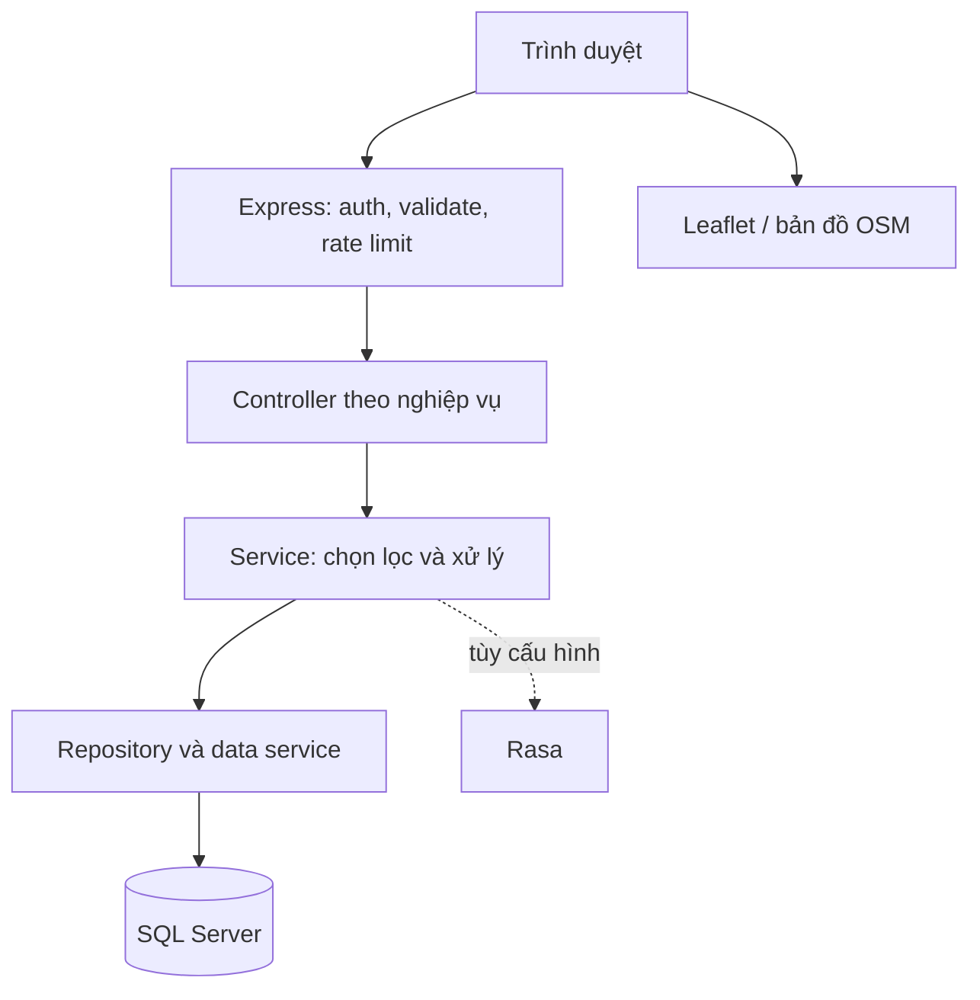
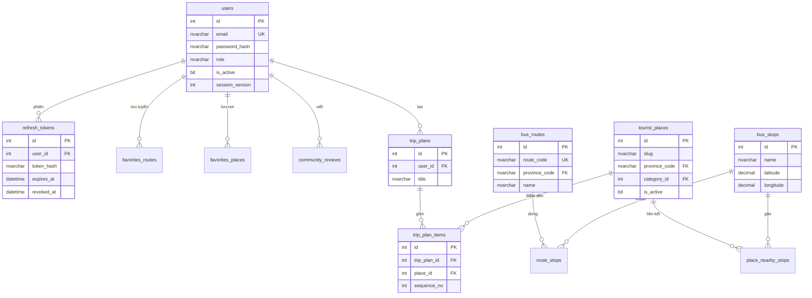

# Kiến trúc, database và API hiện hành

Ứng dụng tích hợp, không tạo frontend/backend rời mới. Giữ Express CommonJS, SQL Server và Leaflet. `backend-api/server.js` đọc cấu hình tại `backend-api/.env` bằng đường dẫn tuyệt đối, mở HTTP; `app.js` phục vụ cả API lẫn `frontend/`. Không mở thư mục gốc, SQL hoặc `.env` qua static HTTP.

API trả JSON envelope `{success,data,message,pagination?}`; chat giữ thêm `reply/intent` ở root để frontend cũ tương thích. Error trả mã HTTP, `errorCode`, `requestId`. Production không trả stack. Các lỗi đầu vào dùng 422, xác thực 401, trái quyền 403, không tồn tại/không thuộc chủ sở hữu 404, email trùng 409, nguồn dữ liệu không sẵn sàng 503 ở các luồng đã sửa.

## ERD nghiệp vụ chính

Đây là ERD rút gọn theo quan hệ logic; `route_code` còn có cột ID nội bộ tùy bảng lịch sử. DDL chính xác, index và foreign key xem SQL `01`, `99`, `06`–`12`; không dùng sơ đồ này thay cho SQL tạo bảng.

| Nhóm bảng | Vai trò |
|---|---|
| users, refresh_tokens | Tài khoản, hash mật khẩu, phiên/thu hồi |
| provinces, bus_routes, bus_stops, route_stops | Danh mục tuyến, tọa độ và thứ tự điểm dừng |
| buses, bus_vehicles, bus_vehicle_locations | Dữ liệu phương tiện và vị trí tham khảo; chưa có nguồn live |
| tourist_categories, tourist_places, place_nearby_stops, place_bus_mappings | Danh mục du lịch và bằng chứng liên kết tới tuyến/bến |
| favorites_routes, favorites_places, place_favorites | Bảng yêu thích kế thừa; hai bảng nơi được ghi nguyên khối, API trả theo user |
| reviews, community_reviews, community_posts và bảng bình luận/vote | Review gắn địa điểm và bài cộng đồng là hai loại nội dung riêng |
| trip_plans, trip_plan_items | Lịch trình và các điểm theo thứ tự |
| chatbot_logs, chatbot_knowledge, activity_logs | Lịch sử hội thoại, tri thức tham khảo và hoạt động |
| reports, notifications, import_history | Báo cáo, thông báo và nhật ký import |
| smartbus_migrations | File migration, SHA-256, thời điểm áp dụng |

Các bảng role/permission và scaffold còn lại từ phiên bản cũ được bảo toàn. Luồng auth hiện dùng `users.role`; token không tự quyết định quyền theo claim được phát lúc trước.

## Route/API

Prefix chuẩn `/api/v1`. Alias `/api` và một số alias không có `/tourism` vẫn được giữ để không phá frontend cũ. Các route ghi yêu cầu `Content-Type: application/json`.

| Method | Route | Quyền / xử lý |
|---|---|---|
| POST | /auth/register, /auth/login | Public, giới hạn tần suất, validate, bcrypt |
| POST | /auth/refresh-token | Refresh hợp lệ, consume atomic và xoay token |
| POST | /auth/logout | Thu hồi refresh được gửi và các phiên tài khoản |
| GET / PUT | /users/me | Tài khoản hiện tại; không nhận role từ client |
| GET | /users/me/{favorite-places,chat-history,community-history,activity-history} | Theo user đăng nhập |
| GET | /routes, /routes/:id | Public; tìm/lọc/phân trang |
| GET | /routes/:id/stops, /routes/:id/buses | Public; quan hệ SQL |
| GET | /stops, /stops/nearest | Public; nearest cần lat/lng hợp lệ |
| GET | /bus/routes, /bus/stops/near | Alias BFF cho giao diện cũ |
| GET | /map/{routes,stops,tourism,vehicles,overview} | GeoJSON/layer metadata, không phải feed live |
| GET | /provinces | Danh mục khu vực của bộ dữ liệu |
| GET | /tourism/categories | Danh mục loại địa điểm |
| GET | /tourism/places | q/keyword, provinceCode/province, category, routeId, limit/page/offset; chỉ active |
| GET | /tourism/places/{search,recommended,near} | Alias/tìm và đề xuất |
| GET | /tourism/places/:id | Chi tiết active, nearby stops, review công khai |
| GET | /tourism/places/:id/{nearby-stops,bus-suggestion,reviews} | Dữ liệu liên kết |
| POST / DELETE | /tourism/places/:id/favorite | User, cùng nghiệp vụ yêu thích |
| GET / POST | /favorite-routes, /favorite-places | User; POST nhận routeId hoặc placeId |
| DELETE | /favorite-routes/:routeId, /favorite-places/:placeId | Chỉ bản lưu của người đăng nhập |
| GET / POST | /reviews | GET bài cộng đồng approved; POST tạo bài cộng đồng pending (admin đăng approved) |
| GET | /reviews/:id | Approved công khai; pending chỉ tác giả/admin |
| GET / POST | /places/:id/reviews | Review gắn tourist place; khác community_reviews |
| PUT / DELETE | /reviews/:id | Route kế thừa thao tác bảng reviews gắn địa điểm, chỉ tác giả/người duyệt |
| POST | /reviews/:id/{vote,report} | Vote cần user; report có rate limit |
| POST | /chatbot/ask, /chat/ask | Public/user, message tối đa 1.000 ký tự; tọa độ tùy chọn |
| GET | /chat/history | Theo người đăng nhập |
| GET | /chat/suggestions | Mẫu câu được hỗ trợ |
| GET | /trip-plans/options | Thời lượng, sở thích, ngân sách |
| POST | /trip-plans/generate | Public xem gợi ý; đăng nhập lưu plan và items transaction |
| GET | /trip-plans/my, /trip-plans/:id | Chỉ chủ sở hữu |
| DELETE | /trip-plans/:id | Chỉ chủ sở hữu |
| GET | /admin/reviews, /admin/reviews/pending | Admin, review cộng đồng |
| POST / PUT | /admin/reviews/:id/approve | Admin duyệt |
| PUT | /admin/reviews/:id/hide | Admin từ chối/ẩn khỏi public |
| DELETE | /admin/reviews/:id | Soft hide |
| GET | /admin/community-posts/pending | Admin |
| POST | /admin/community-posts/:id/{approve,reject} | Admin |
| GET / POST | /admin/places | Admin list (có inactive), tạo |
| PUT / DELETE | /admin/places/:id | Admin sửa/ẩn |
| GET | /admin/stats/recent-activities | Admin |
| GET | /stats/overview | Public counts; admin có thêm số quản trị |
| GET | /stats/recent-activities | User chỉ cá nhân, admin/moderator có thể xem toàn bộ |
| GET / POST | /reports | GET admin/moderator; POST theo route hiện hành |
| GET | /analytics/summary | Admin/moderator |
| GET | /notifications | User |
| GET | /import/history | Admin/moderator |
| POST | /import/{bus-data,tourism-data} | Admin, JSON `{items:[...]}` tối đa 200 dòng, không nhận đường dẫn tệp |
| GET | /health, /health/{liveness,db,readiness} | Public chẩn đoán; readiness/DB dùng 503 khi mất kết nối |
| GET | /runtime-config.js | Cấu hình public cùng origin, không có bí mật |

Tất cả route phụ/community/analytics/report cụ thể nằm trong `backend-api/modules/*/*.routes.js`. File `app.js` là nơi xem prefix và alias thực tế. Giới hạn lịch sử: GET cộng đồng và PUT/DELETE review dùng hai bảng khác nhau; frontend không cung cấp sửa bài cộng đồng qua PUT này. Nếu mở rộng API, tách `/community-reviews` và `/place-reviews` theo version để tránh nhầm ID.

## Các điểm thiết kế quan trọng

1. `auth.middleware.js` kiểm HS256, loại token, phiên bản phiên, trạng thái và role **hiện tại trong SQL**. Vì vậy JWT cũ không giữ được quyền admin sau khi tài khoản đổi quyền/khóa.
2. `auth.repository.consumeRefreshToken` dùng một UPDATE có điều kiện và OUTPUT. Hai request dùng cùng refresh chỉ một request nhận được bản ghi và phát token mới. UUID jti tránh token giống nhau trong cùng giây.
3. `scripts/migrate.js` dùng transaction + khóa ứng dụng + checksum. File SQL đã ghi journal không sửa; migration 12 khắc phục view06 mà không viết lại lịch sử.
4. `trip.repository.savePlan` và import JSON dùng transaction. Không trả “đã lưu” khi chỉ ghi được một phần; lỗi nguồn SQL không đổi sang bộ điểm đến giả để che lỗi.
5. `tourism.repository.placeFilters` dùng chung WHERE trước OFFSET cho count và rows, tránh số trang sai khi có route/GPS/active filter. Mọi giá trị truy vấn được bind thành tham số.

## Biên bảo mật và vận hành

- API Bearer không dùng cookie đăng nhập tự gửi. Request cross-site không tự mang token; CORS có allowlist. Nếu chuyển sang cookie sau này phải bổ sung CSRF token và SameSite đúng mô hình.
- CSP chặn inline script handler, frontend retry/chat/navigation đã dùng event listener. Nội dung hiển thị được escape/sanitize; không coi đây là bằng chứng kiểm toán XSS toàn diện.
- Pool SQL có timeout; middleware rate limit theo IP. Khi dùng reverse proxy cấu hình TRUST_PROXY đúng topology, không bật vô điều kiện.
- Không có OAuth GitHub trong SmartBus: xác thực email/mật khẩu của riêng ứng dụng.
- Các log hoạt động kế thừa dùng best effort; lỗi ghi activity không chặn thao tác chính. Chưa có hàng đợi/audit bất biến bảo đảm lưu mọi sự kiện.
